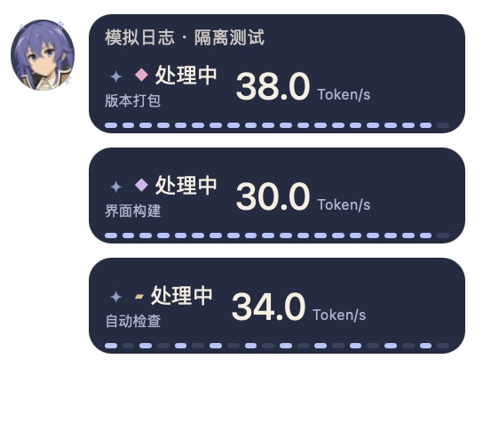
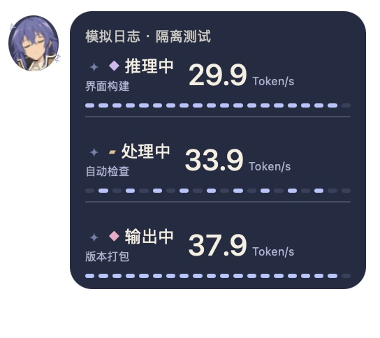
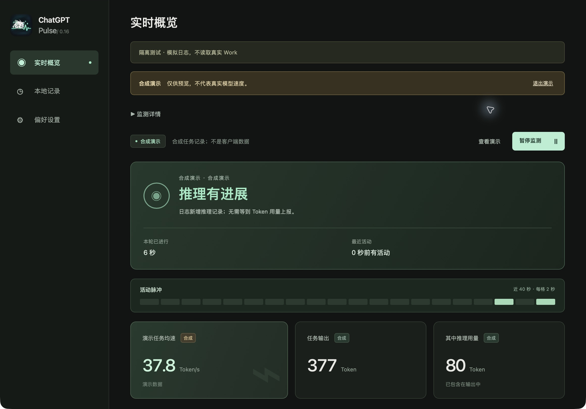
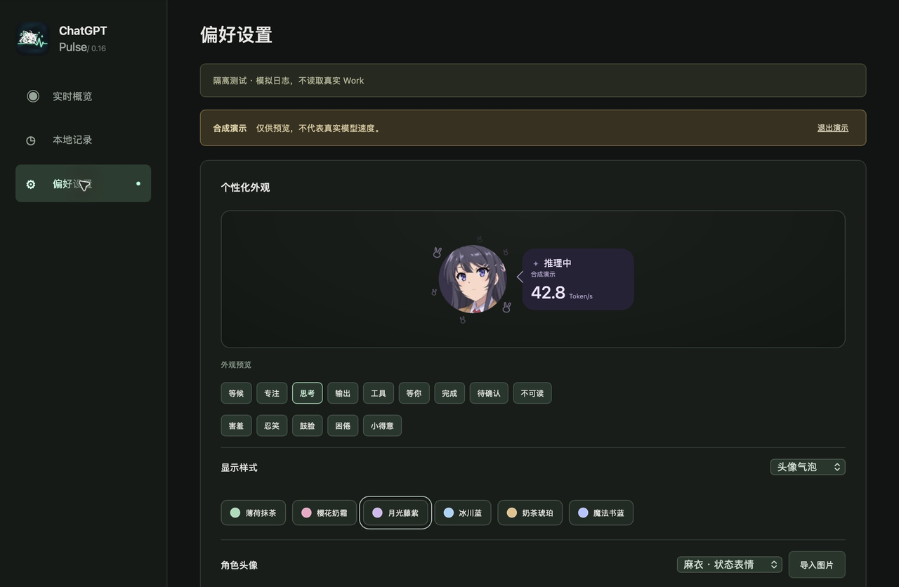
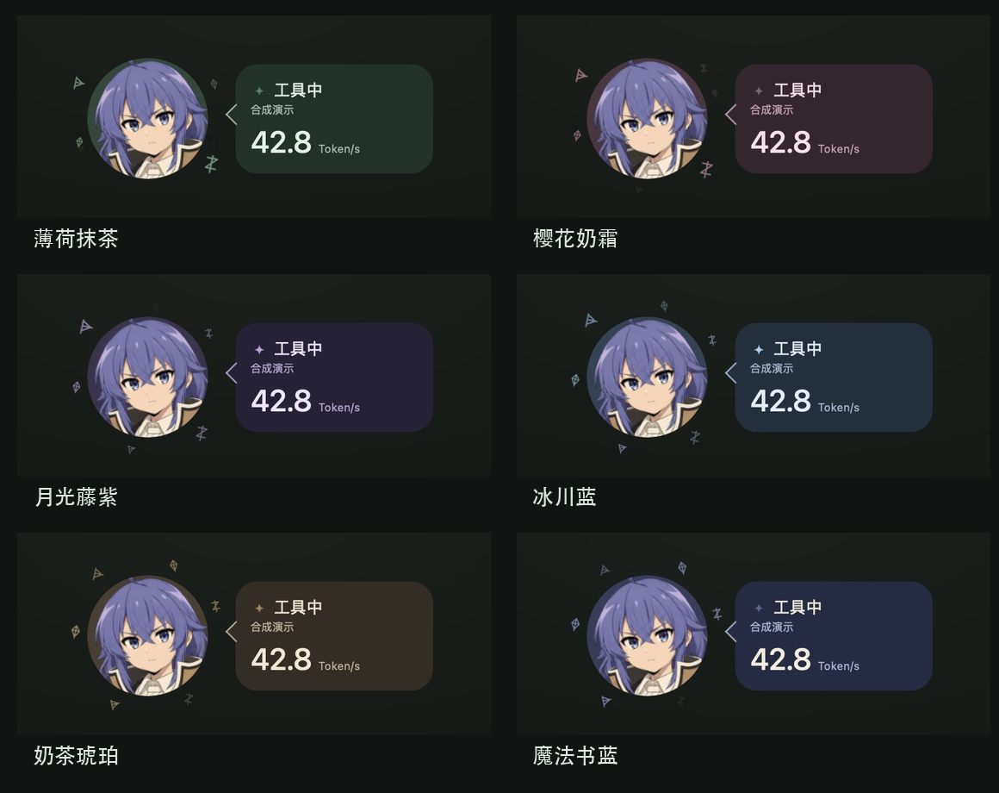

# ChatGPT Pulse

简体中文 · [English](README.en.md)

Mac / Windows 桌面上的 Work / Codex 工作监测与角色悬浮窗。读取本机兼容会话日志，显示工作状态、日志报告的 Token 用量和区间速率。Tauri 2 + Rust + Svelte + SQLite。

免费供个人及组织内部使用，源码公开；项目代码适用非商业基础许可与内部使用附加许可。本项目为非官方、非商业同人项目，与 OpenAI 及原作官方均无关联。

## 实机演示

**0.18.3 Mac 音乐律动实录**：生成测试音源经系统输出播放，频谱由真实 Core Audio 采集驱动。画面仅录制应用自身窗口，未读取聊天；等待中的 Token 不是模型测速。

| 麻衣 · 半环频谱 | 洛琪希 · 横条频谱 |
|---|---|
|  |  |

[录制方法与校验](docs/media/music-capture-manifest.json) · [音频冷启动修复与验证](docs/MAC_AUDIO_STARTUP_0.18.3.md)


以下为 **Mac 上运行的 0.16.6 桌面应用**，使用自带演示或隔离模拟日志。数字仅用于展示界面，不代表真实模型速度；没有使用真实聊天。更多画面及录制说明见 [实机演示图集](docs/DEMOS.md)。

| 点击头像互动 · 实际悬浮窗 | 洛琪希表情与符文 · 应用内预览 |
|---|---|
|  |  |

| 多个任务气泡 | 一个气泡分行显示 |
|---|---|
|  |  |

<details>
<summary>展开实时概览、个性化设置与六种主题</summary>







[查看完整图集：麻衣／洛琪希动效、并行任务、图片裁剪及录制说明](docs/DEMOS.md)

</details>

## 功能

- 自动发现并跟随兼容工作日志；多个任务共享一个头像，可选择多个气泡或合并显示。
- 悬浮条与圆形头像两种布局，支持拖动、锁定、贴边收纳、渐隐和自定义图片裁剪。
- 麻衣、洛琪希角色主题，状态表情、飘动粒子、随机空闲互动、勿扰和减少动态效果。
- 本地数字摘要可选保存，默认关闭；不保存聊天正文，不调用额外 AI 或收费 API。

## 音乐律动

新增系统播放音频频谱、确认空闲时的人物律动及音乐话题，默认关闭；不访问麦克风、不保存或上传音频。Mac 使用 Core Audio（采集需 14.2+），Windows 使用 WASAPI 回环（采集需 Windows 10 1703+）。提供六种频谱、条带对比度及可保存/分享的外观方案；工作和用户交互优先。

当前统一提供 Mac 0.18.3 与 Windows 0.18.2 的已验收安装器。安装资产与两端验证范围见 [当前版本说明](docs/RELEASE_0.18.3.zh-CN.md)，功能见 [音乐律动](docs/MUSIC_REACTIVE.md) 和 [频谱工作室](docs/SPECTRUM_STUDIO.md)。

本轮维护修复与实测范围见 [2026-10-29 检查记录](docs/MAC_REVIEW_20261029.md)。Mac 从 0.16.6 升级需重新设置偏好及音频权限，旧数据保留；当前音乐版用户沿用原设置。

## 安装与使用

最新 **0.18.3 Mac 修复版**（Windows 音乐版仍为 0.18.2）：从 [GitHub Releases](https://github.com/voidlph-dev/chatgpt-pulse/releases/tag/v0.18.3) 下载适合你系统的安装包。

| 下载文件 | 用途 |
|---|---|
| [`ChatGPT-Pulse-0.18.3-mac-universal.dmg`](https://github.com/voidlph-dev/chatgpt-pulse/releases/download/v0.18.3/ChatGPT-Pulse-0.18.3-mac-universal.dmg) | Mac 安装盘，打开后将应用拖到 Applications；包含 Apple Silicon 与 Intel，最低 macOS 13.3 |
| [`ChatGPT-Pulse-0.18.2-windows-x64-music-offline-setup.exe`](https://github.com/voidlph-dev/chatgpt-pulse/releases/download/v0.18.3/ChatGPT-Pulse-0.18.2-windows-x64-music-offline-setup.exe) | Windows 默认完整离线安装器，包含微软 WebView2 安装组件 |
| [`ChatGPT-Pulse-0.18.2-windows-x64-music-online-setup.exe`](https://github.com/voidlph-dev/chatgpt-pulse/releases/download/v0.18.3/ChatGPT-Pulse-0.18.2-windows-x64-music-online-setup.exe) | Windows 小体积联网版，缺少 WebView2 时需联网下载 |
| [`ChatGPT-Pulse-0.18.3-source.zip`](https://github.com/voidlph-dev/chatgpt-pulse/releases/download/v0.18.3/ChatGPT-Pulse-0.18.3-source.zip) | 两平台统一源码，不含开发工具、个人日志和数据库 |

使用者无需 Node、Rust、Python 或开发服务器。Mac 步骤见 [Mac 安装说明](docs/MAC_INSTALL.md)，Windows 两个安装器任选其一，见 [Windows 使用说明](docs/WINDOWS_INSTALL.md)。Windows EXE 未签名，可能出现发布者未知提示；无需关闭系统安全功能。下载后可按 [`SHA256SUMS`](https://github.com/voidlph-dev/chatgpt-pulse/releases/download/v0.18.3/SHA256SUMS.txt) 核对 Mac 和 Windows 文件；当前安装器统一在最新发布页下载。PowerShell 步骤见 [Windows 下载校验](docs/WINDOWS_INSTALL.md#下载与校验)。

默认读取当前用户的 `~/.codex/sessions`。若客户端配置了自定义位置，Pulse 进程可通过绝对路径环境变量 `CODEX_HOME` 指向该目录。普通 ChatGPT 聊天、浏览器聊天和不生成兼容本地日志的客户端不在支持范围内。工作日志监测无需辅助功能、屏幕录制或全磁盘访问权限；可选音乐律动需要系统音频录制授权。

悬浮窗右键打开菜单；Mac 用 `⌘⌃⌥P`、Windows 用 `Ctrl+Alt+Shift+P` 编辑，也可在主窗口点击“编辑悬浮条”。点击头像互动，按住拖动，编辑后可完成或取消。在设置里可选择“随 GPT 启动”。关闭主窗口仍在后台运行；Mac 从菜单栏菜单或用 `⌘Q` 退出，Windows 从系统托盘菜单退出。

| 平台 | 当前状态 |
|---|---|
| Apple Silicon Mac | 0.18.2 本机验收范围见 [Mac 验收说明](docs/MAC_ACCEPTANCE.md) |
| Intel Mac | 已生成通用二进制中的 Intel 架构；尚无 Intel 实机验收 |
| Windows x64 | 音乐安装器为原交付本机验收版；仓库后续维护源码已通过 Windows 云端测试/编译、未重新实机安装，Windows 10/其他机器仍待验证，见 [Windows 音乐报告](docs/WINDOWS_MUSIC_REPORT.md) |
| Chrome / 普通聊天 | 暂不支持 |

Mac 包使用临时签名，尚未完成 Apple Developer ID 签名与公证。本阶段不购买签名或公证服务，提供明确标注未公证的测试包；其他 Mac 下载后可能出现系统安全提示，仍需异机测试，参见 [发布清单](docs/RELEASE.md)。不能保证所有系统版本、日志格式或电脑都可用。

## 数据如何理解

Token 来自客户端日志；任务起始基线不足时明确显示“会话累计输出”，不冒充本轮用量。Token/s 是上报区间的计算值，包含推理或工具间隔，不能当作模型逐秒解码速度。没有数据时显示 `—`；长时间没有上报不代表模型停止。完整口径和隐私边界见 [数据说明](docs/DATA.md)。

## 从源码构建

需要 Node.js 22.13+（建议 24）、pnpm 11.25、Rust 1.88+，以及 [Tauri 平台构建依赖](https://v2.tauri.app/start/prerequisites/)。Mac 需要苹果命令行工具，无需完整 Xcode；SQLite 随程序编译，无需单独安装。终端进入源码目录后：

```sh
pnpm install --frozen-lockfile
pnpm test
pnpm tauri dev
```

Mac 通用版：

```sh
rustup target add aarch64-apple-darwin x86_64-apple-darwin
./scripts/build.sh --target universal-apple-darwin --bundles app,dmg
```

上述默认配置使用桌面身份。复现本次 Mac 发布包时运行 `sh scripts/build-music-preview.sh`，使用发布包的音乐版身份；两种身份的升级边界见 [Mac 安装说明](docs/MAC_INSTALL.md#音乐版升级)。

应用位于 `src-tauri/target/universal-apple-darwin/release/bundle/macos/`，安装盘位于同级 `dmg/`。源码可使用常规系统工具链；`.tools` 仅在存在本地工具链时启用，不是运行依赖。用户只下载安装包时无需 Node、Rust、Python 或 VS Code。

验证与贡献方法见 [CONTRIBUTING.md](CONTRIBUTING.md)。GitHub CI 配置包含 Mac 通用构建、原生测试、浏览器回归及 Windows 实验性编译检查；本地准备完成不等于这些云端流程已经跑过。

Windows 安装、使用与边界见 [使用说明](docs/WINDOWS_INSTALL.md)，源码构建与测试见 [构建说明](docs/WINDOWS_BUILD.md)。本机验收见 [Windows 验收报告](docs/WINDOWS_ACCEPTANCE.md)，公开发行剩余事项见 [发布准备](docs/RELEASE_READINESS.md)。

## 许可与资源

项目代码使用 [PolyForm Noncommercial 1.0.0 ＋ 内部使用附加许可 1.0](LICENSE)：允许个人、自由职业者及公司内部免费使用，不授权收费转卖、集成进对外付费产品或提供付费服务。完整场景见 [许可说明](docs/LICENSING.md)。这属于源码公开项目，不宣称使用 OSI 开源许可。

麻衣、洛琪希图集是 AI 辅助制作的非官方同人素材，不是官方动画截图或官方授权素材。原角色及作品相关权利归各自权利人，项目代码许可不授予角色素材的相关权利，也不表示获得官方授权或背书；来源与制作记录见 [素材说明](docs/ASSETS.md)。角色台词是原创中文互动，不是原作字幕、官方翻译或实时 AI 回复。依赖许可见 [THIRD_PARTY_NOTICES.txt](THIRD_PARTY_NOTICES.txt)。

若对素材权利有疑问，可通过仓库 Issues 提出具体素材与权利依据，维护者会核查处理。请勿在公开 Issue 中提交私人联系方式、聊天正文或账号信息。

本项目与 OpenAI 无官方关联。更新记录见 [CHANGELOG.md](CHANGELOG.md)。
