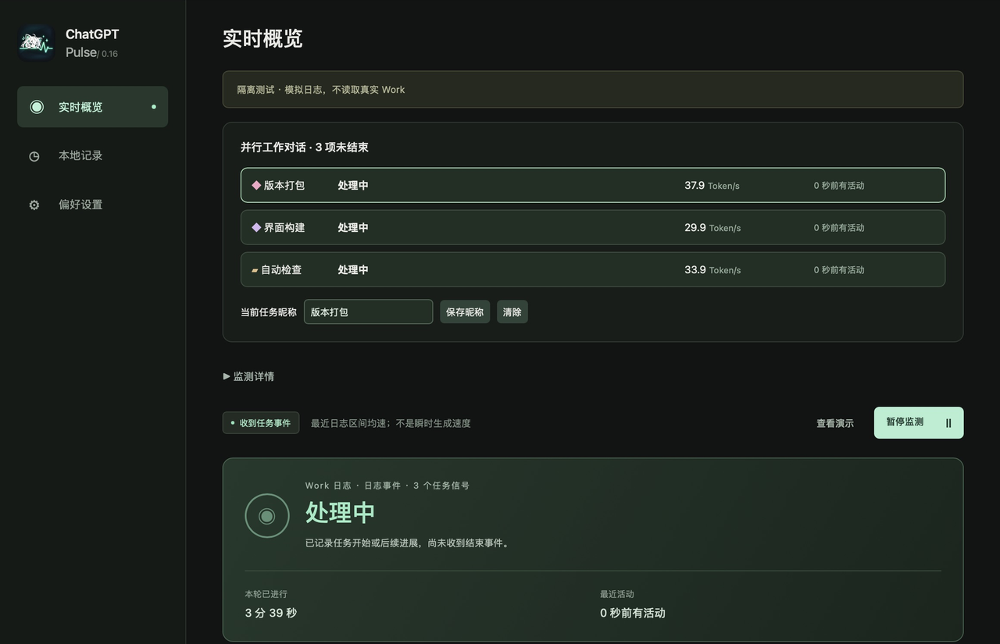
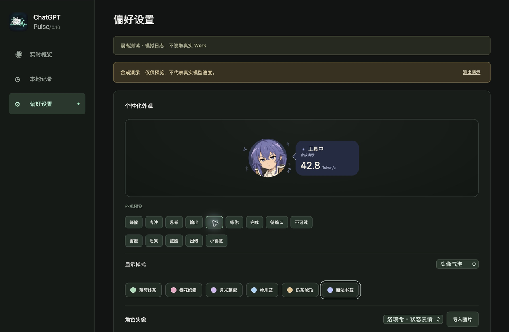
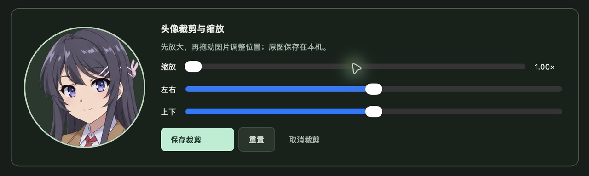

# 实机演示 / Native demos

[返回中文首页](../README.md) · [English README](../README.en.md)

本页为 **0.16.6 Mac 桌面应用的真实运行画面**，于 2026-10-25 在 Apple Silicon、macOS 27.0.1 上采集。应用二进制与本次发布的 Mac 通用版相同。内容使用自带合成演示，或隔离目录里的纯数值模拟日志；没有展示真实聊天或账号信息。图中的 Token/s 不是实测速率或性能承诺。

These are real captures of the packaged Mac desktop app, not browser mockups. Data comes from the built-in demo or isolated synthetic fixtures. Token/s values are illustrative, not benchmarks. Settings previews are labelled below. No Windows screenshot is included or implied.

## 点击头像：对话、表情与兔子粒子

实际桌面头像悬浮窗的连续录制。点击后显示逐字对话，人物表情和粒子随界面变化；使用软件自带合成演示。互动文字为程序内置内容。

静态悬浮窗：

## 两名角色的状态与表情

下列动图来自桌面应用“偏好设置”的外观预览，手动切换表情按钮；保留真实过渡帧，截取并拼接展示片段，不代表自然任务按此顺序发生。

| 麻衣：害羞、忍笑、鼓脸与工作状态 | 洛琪希：思考、工具、害羞、困倦与完成 |
|---|---|
|  |  |

## 并行任务：一个头像，两种显示方式

三个模拟工作日志由桌面应用自动发现并同时读取。两种方案都只保留一个人物，各任务的数字与活动记录分别显示。界面构建、自动检查、版本打包为演示用昵称。

| 多个气泡，上下排列 | 一个气泡，分行显示 |
|---|---|
|  |  |

主窗口中的并行任务列表：

## 实时概览

工作状态、最近活动、活动脉冲及 Token 数字的桌面主界面。本图使用自带合成演示。

## 个性化设置与主题

头像气泡、简洁悬浮条、角色、表情和配色可在同一个设置页调整。以下为桌面应用内的预览界面。

六种主题，每格均来自同一桌面应用中实际选择该配色后的预览截图：

## 自定义头像裁剪

实际导入一张项目已有图集中的单帧头像，再打开裁剪面板并保存。支持缩放及左右、上下位置调整；本图只展示裁剪操作，不使用私人图片。

## 采集与数据说明

- 通过原生窗口采集截图，动图由这些实际截图编码。仅进行边缘裁剪、等比例缩放、截图拼图与 GIF 压缩，没有 AI 合成界面、替换数值或补画人物。
- 动图在 GitHub 中自动循环；需要静态画面时可查看本页 PNG。
- 悬浮窗的透明区域在采集结果中显示为白色；白底不是产品新增的外框。
- 模拟日志与自带演示不验证真实 Work 的输出速度。生产版仍按兼容日志报告的事件与用量工作，详细口径见 [数据说明](DATA.md)。
- 这些是 Mac 实机素材。Windows 安装包与验收范围见 [Windows 验收](WINDOWS_ACCEPTANCE.md)，本页不把 Mac 截图当作 Windows 实机截图。
- 角色素材与项目许可说明继续适用，见 [素材说明](ASSETS.md) 与 [许可说明](LICENSING.md)。

逐个文件的分辨率、帧数、校验值和采集说明见 [capture-manifest.json](media/capture-manifest.json)。
