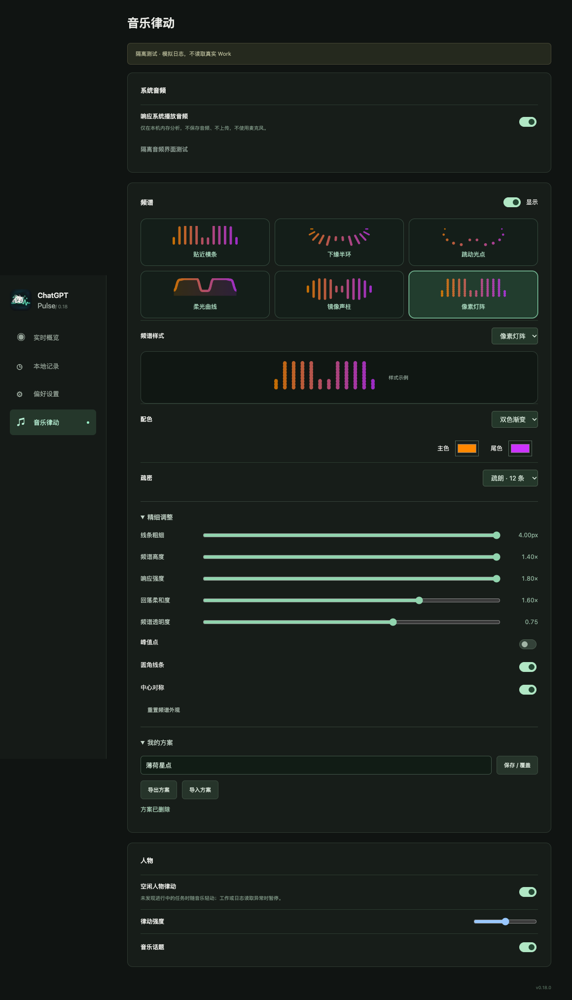

# 频谱工作室

在「音乐律动」中选择样式；无需开启音频即可预览和配置。卡片与预览使用固定示例数据，悬浮窗使用实时系统播放音频。未启用音频时，调整外观不会触发采集。

## 样式与参考

| 样式 | 表现 |
| --- | --- |
| 贴近横条 | 原有紧凑柱状频谱 |
| 下缘半环 | 保留 0.17.3 中间饱满、两侧渐细的形态 |
| 跳动光点 | 用轻量光点显示频段端点 |
| 柔光曲线 | 连接频率能量形成曲线，可调整填充 |
| 镜像声柱 | 每根声柱从中线向上下伸展 |
| 像素灯阵 | 用分段笔画形成 LED 感 |

设计参考（2026-10-28 检索）：

- [audioMotion 设置说明](https://audiomotion.app/docs/settings.html)：柱、曲线、LED、径向、峰值及渐变/预设管理。
- [audioMotion fluid demo](https://audiomotion.dev/demo/fluid.html)：可调整线宽、间隔、镜像及峰值行为的交互参考。
- [Rainmeter AudioLevel 文档](https://docs.rainmeter.net/manual/plugins/audiolevel/)：频段、灵敏度与平滑控制的参数设计参考。
- [MDN 音频可视化说明](https://developer.mozilla.org/en-US/docs/Web/API/Web_Audio_API/Visualizations_with_Web_Audio_API)：频域与时域可视化的区别。
- [wavesurfer 官方示例](https://wavesurfer.xyz/examples/)：渐变、定制绘制及频谱图的视觉参考。
- [Butterchurn 项目](https://github.com/jberg/butterchurn)：预设式可视化的探索参考。此次没有集成其引擎、着色器或预设素材。

所有新增绘制代码为本项目实现，没有增加可视化依赖、远程内容或联网采集。

## 界面示例

下图是生产界面的隔离浏览器预览，使用固定合成频段和自定义测试参数，不是系统音频实测。

## 自定义

- 跟随主题、自选单色、双色渐变、彩虹频段。
- 12 / 18 / 24 条；较疏的显示也会聚合全部 24 个分析频段，不抽掉某些频率。
- 粗细 1–4、高度 0.6–1.4、响应强度 0.5–1.8、回落柔和度 0.5–2、透明度 0.3–1。
- 峰值点、圆角、中心对称；频谱曲线填充 0–40%。
- 控件变化先显示静态示例；释放滑块后保存并更新悬浮窗。主题配色预览跟随角色主题。重复快照不会打断未提交的滑块预览。

粗细和高度受窗口范围及粒子区域限制，最大值不会扩展窗口或覆盖工作粒子。所有样式不接收鼠标事件。系统减少动态效果继续限制刷新，窗口隐藏或音频过期时停止。自定义只影响显示，原始分析、工作监测及 Token 数据不变。

这些图形均来自频域数据。曲线不是原始 PCM 波形；镜像是同一频段的装饰性布局，不代表独立左右声道。

## 方案

最多保存 12 个命名方案；同名保存会覆盖。方案保存在应用本地设置中。导出显示方案文本，可复制分享；导入支持粘贴文本或读取 JSON 文件。单个导入最多 16 KB。取消、无效 JSON 或不支持的版本不会修改当前外观。

分享格式为 `type: chatgpt-pulse-spectrum`、`version: 1`、`style` 和 `visual`。导入只读取白名单字段，颜色只允许六位十六进制，数值受范围限制。不运行代码、不读取链接，不携带音频开关、工作日志路径、人物、用户身份或聊天内容。应用方案在一次设置更新中写入样式与参数。

最终验收记录见 `release/SPECTRUM_STUDIO_VALIDATION.json`。浏览器预览及截图使用合成特征；原生系统音频验收另行标明，不混作实测。

## 0.18.1 条带长短对比

新增「精细调整 → 条带对比度」（1–3×，默认 2×）。视觉层以当前频段的较低分位数为参考，适量压低共同底部，让相近频段的差别更明显；原始音频特征不变。1× 为中性映射。条带和峰值共用参考；高响应强度改用软增益，保留较强频段之间的差异。所有输入仍按相同单调函数处理，相同频段值不会凭空出现不同高度，静音保持静止。对比度随命名方案、导入导出一起保存；旧方案缺省采用 2×。
